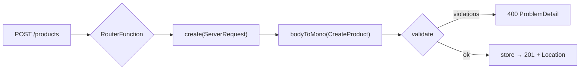

# 1. Functional Endpoints: CRUD with Validation

<span class="level l1">L1</span> ★★☆ · `RouterFunction`, `ServerRequest`/`ServerResponse`, manual validation, ProblemDetail

## Problem

> Implement `POST /products`, `GET /products/{id}` and `DELETE /products/{id}` with **functional endpoints** (no `@RestController`).
> Validate the body and return **201 + Location**, **404** and **400**, each as a ProblemDetail that lists every violation.

## Key idea

A `RouterFunction` maps requests to handler functions (`ServerRequest -> Mono<ServerResponse>`). Nothing is implicit: you
decode the body with `bodyToMono`, **call the validator yourself**, and build responses explicitly. Use `switchIfEmpty(Mono.defer(...))`
for 404 so the error response is only built when it's needed.



## Solution

```java title="P01ProductRouter.java"
--8<-- "playbook-examples/src/main/java/com/example/reactive/playbook/codinginterview/P01ProductRouter.java"
```

```java title="P01ProductRouterTest.java"
--8<-- "playbook-examples/src/test/java/com/example/reactive/playbook/codinginterview/P01ProductRouterTest.java"
```

## Walkthrough

| Code | Why |
|---|---|
| `route().path("/products", b -> b.GET("/{id}", this::get).POST("", this::create).DELETE(...)).build()` | Nested routes keep one prefix and read like a routing table, so you can test them without a Spring context (`WebTestClient.bindToRouterFunction`). |
| `.switchIfEmpty(Mono.error(new IllegalArgumentException("request body is required")))` | An empty body is a client error, not a silently empty `Mono` that completes with no response. |
| `.flatMap(this::validate)` | Functional endpoints have no `@Valid`, so validation is an explicit step that returns either the value or an error. |
| `.switchIfEmpty(Mono.defer(() -> problem(NOT_FOUND, ...)))` | `defer` builds the 404 response lazily. Without it, the response Mono is assembled on every call, found or not. |
| `.onErrorResume(IllegalArgumentException.class, e -> problem(BAD_REQUEST, e.getMessage()))` | Map the domain error to HTTP in the handler. A `WebExceptionHandler` would centralise this across routes. |

## Complexity

| Approach | Time | Space |
|---|---|---|
| per request | O(1) map ops + validation | O(products) |

## Run it

```bash
./gradlew :playbook-examples:test --tests '*P01ProductRouterTest'
```

```text
--8<-- "coding-interview/outputs/P01ProductRouterTest.txt"
```

## Common mistakes

* Forgetting that `bodyToMono` on an empty body completes **empty**, so the chain does nothing and returns an empty response.
* Calling `.block()` in a handler to get the body. That blocks the event loop.
* Using `switchIfEmpty(problem(...))` without `defer`. It works, but the response is assembled eagerly every time.

## Follow-up questions

??? question "Annotated controllers vs functional endpoints: when would you choose each?"
    Annotated controllers are familiar, with declarative validation and less code. Functional endpoints give explicit, composable routing (routes are values you can build in code, filter and test without a context), suit lightweight apps, and keep request handling free of reflection. Both run on the same WebFlux engine.

??? question "How do you add a cross-cutting filter to a router?"
    `routes().filter((req, next) -> ...)` for per-router filters (auth checks, timing), or a `WebFilter` bean for the whole application.
