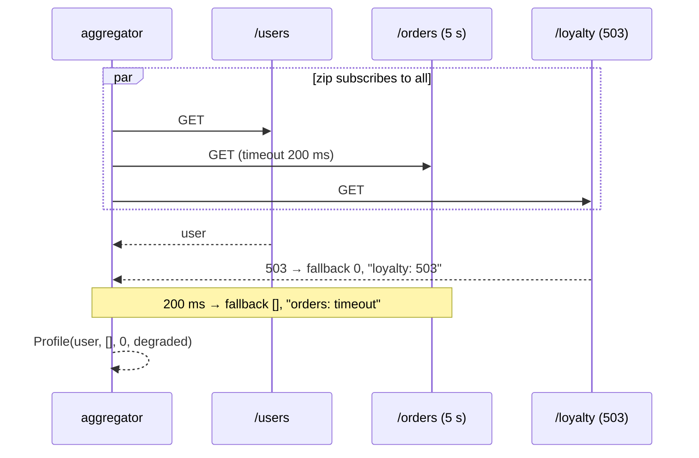

# 2. WebClient Fan-Out with Partial Fallbacks

<span class="level l2">L2</span> ★★☆ · `Mono.zip`, per-call `timeout`, `onErrorResume`, required vs optional

## Problem

> A profile page needs the **user** (required), **recent orders** and **loyalty points** (optional). Call the three services **in
> parallel**. A slow or failing optional service gives a fallback and a "degraded" note, while a failing required call fails the
> whole response. Test it **without a network**.

## Key idea

`Mono.zip` subscribes to all its sources **at once**, so latency is that of the slowest call. Each optional call gets its own
`timeout` and `onErrorResume`, which turn failure into a value. Here that value is a small `Result` carrying the fallback and the reason,
so zip never sees an error from it. The test plugs a stub **`ExchangeFunction`** into the real `WebClient`, which keeps the actual
encoding and decoding but needs no server.



## Solution

```java title="P02ProfileAggregator.java"
--8<-- "playbook-examples/src/main/java/com/example/reactive/playbook/codinginterview/P02ProfileAggregator.java"
```

```java title="P02ProfileAggregatorTest.java"
--8<-- "playbook-examples/src/test/java/com/example/reactive/playbook/codinginterview/P02ProfileAggregatorTest.java"
```

## Walkthrough

| Code | Why |
|---|---|
| `Mono.zip(user, orders, points)` | Parallel by construction. The first test asserts that three 100 ms calls finish in well under 300 ms. |
| `.timeout(optionalTimeout).map(Result::ok).onErrorResume(e -> Mono.just(Result.fallback(...)))` | The order matters: the timeout must sit *before* `onErrorResume`, so the timeout error is what gets converted into the fallback. |
| `bodyToFlux(Order.class).take(3).collectList()` | `take(3)` cancels the upstream after three items, so a long list isn't downloaded. |
| `WebClient.builder().exchangeFunction(req -> ...)` | A test seam built into WebClient. Responses are created with `ClientResponse.create(status).body(json)`. |
| `expectError(WebClientResponseException.NotFound.class)` | The required call has no fallback, so `retrieve()` turns the 404 into an exception that fails the zip. |

## Complexity

| Approach | Time | Space |
|---|---|---|
| latency | max(call latencies, bounded by timeouts) | O(response sizes) |

## Run it

```bash
./gradlew :playbook-examples:test --tests '*P02ProfileAggregatorTest'
```

```text
--8<-- "coding-interview/outputs/P02ProfileAggregatorTest.txt"
```

## Common mistakes

* Using `flatMap` chains (`user.flatMap(u -> orders...)`), which makes the calls sequential: latency is the sum.
* `onErrorResume` before `timeout`, so the timeout fires after the fallback point and fails the zip.
* Letting an optional source complete *empty*. `zip` then completes empty and the whole profile disappears. Always map to a value.

## Follow-up questions

??? question "zip vs zipWhen vs Mono.when?"
    `zip` combines independent sources in parallel. `zipWhen` runs the second source *after* the first, with the first's value (dependent calls). `when` waits for completion and ignores values, which suits fire-and-forget side effects.

??? question "How do you add retries and circuit breaking?"
    Add `retryWhen(Retry.backoff(2, 100ms).filter(transient))` per call, inside the timeout budget, and Resilience4j's `transformDeferred(CircuitBreakerOperator.of(cb))`, or Spring Cloud Circuit Breaker's `ReactiveCircuitBreaker`. Problem 12 builds one by hand.
