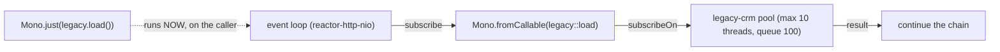

# 3. Calling Blocking Code from WebFlux

<span class="level l2">L2</span> ★★☆ · `Mono.fromCallable`, `subscribeOn`, dedicated bounded scheduler, `Mono.just` trap

## Problem

> A legacy CRM SDK is **blocking** (50 ms per call). Call it from a WebFlux service **without blocking the event loop**, make it lazy,
> give it a timeout, and stop a slow CRM from exhausting the threads that other blocking work needs.

## Key idea

Wrap the call in **`Mono.fromCallable`**, which is lazy and runs once per subscription, and move execution with **`subscribeOn`**
to a **dedicated, bounded** scheduler (`Schedulers.newBoundedElastic(10, 100, "legacy-crm")`). The tests prove which thread did the work,
that nothing runs before subscription, and that `Mono.just(blockingCall())` runs **at assembly time on the caller's thread**.



## Solution

```java title="P03BlockingBridge.java"
--8<-- "playbook-examples/src/main/java/com/example/reactive/playbook/codinginterview/P03BlockingBridge.java"
```

```java title="P03BlockingBridgeTest.java"
--8<-- "playbook-examples/src/test/java/com/example/reactive/playbook/codinginterview/P03BlockingBridgeTest.java"
```

## Walkthrough

| Code | Why |
|---|---|
| `Mono.fromCallable(() -> legacy.loadCustomer(id))` | Lazy: the callable runs when someone subscribes, once per subscription, as the second test proves. |
| `.subscribeOn(blockingPool)` | Moves the *subscription* (and so the callable) onto the pool. Its position in the chain doesn't matter for the source. |
| `Schedulers.newBoundedElastic(10, 100, "legacy-crm")` | A bulkhead: at most 10 threads and 100 queued tasks for this dependency. The shared `boundedElastic()` is used by everything else. |
| `Mono.just(legacy.loadCustomer(id))` | The classic trap: the argument is evaluated immediately, before any subscriber exists, on whatever thread built the pipeline. That's often the event loop. |
| `flatMap over 10 ids → < 400 ms` | Ten 50 ms calls run in parallel on the pool rather than one after another. |

## Complexity

| Approach | Time | Space |
|---|---|---|
| per call | blocking time, on a pool thread | 1 pool thread while running |

## Run it

```bash
./gradlew :playbook-examples:test --tests '*P03BlockingBridgeTest'
```

```text
--8<-- "coding-interview/outputs/P03BlockingBridgeTest.txt"
```

## Common mistakes

* `Mono.just(blocking())` or `Mono.fromCallable(...)` without `subscribeOn`: both block the event loop.
* Using `publishOn` to fix a blocking *source*. `publishOn` only moves the operators *after* it.
* Using `Schedulers.parallel()` for blocking I/O. It has one thread per core, and blocking them starves all CPU work.
* Running a blocking JDBC repository inside WebFlux at high load. Prefer R2DBC, or use Spring MVC on virtual threads.

## Follow-up questions

??? question "How do you detect accidental blocking calls?"
    Use BlockHound (`BlockHound.install()` in tests): it throws when a blocking call such as `Thread.sleep`, socket reads or `FileInputStream.read` happens on a non-blocking thread. Reactor-tools' `ReactorDebugAgent` helps trace where it came from.

??? question "With virtual threads, is WebFlux still worth it?"
    For request/response services over blocking libraries, Spring MVC on virtual threads is simpler and often just as scalable. WebFlux still shines for streaming (SSE, WebSockets), backpressure, and composing many async sources.
