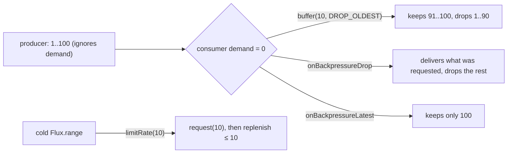

# 4. Backpressure: Buffer, Drop or Keep Latest

<span class="level l3">L3</span> ★★★ · `onBackpressureBuffer` + `DROP_OLDEST`, `onBackpressureDrop`, `onBackpressureLatest`, `limitRate`

## Problem

> A producer pushes 100 events and **ignores demand** (UI events, a sensor, a hot feed). The consumer is slow. Implement and test
> three policies: **bounded buffer keeping the newest**, **drop while busy**, and **keep only the latest**. Also show a cold source
> consumed in **batches of 10**.

## Key idea

Backpressure operators sit between a producer that can't slow down and a consumer that requests at its own pace. They decide
**what to lose** when demand is zero: the oldest (`DROP_OLDEST`), new arrivals (`onBackpressureDrop`), or everything but the
latest. For sources that *can* slow down, `limitRate(n)` turns unbounded demand into batches.



## Solution

```java title="P04Backpressure.java"
--8<-- "playbook-examples/src/main/java/com/example/reactive/playbook/codinginterview/P04Backpressure.java"
```

```java title="P04BackpressureTest.java"
--8<-- "playbook-examples/src/test/java/com/example/reactive/playbook/codinginterview/P04BackpressureTest.java"
```

## Walkthrough

| Code | Why |
|---|---|
| `Flux.create(sink -> ..., FluxSink.OverflowStrategy.IGNORE)` | Simulates a producer that pushes regardless of demand, so the downstream operator is what has to cope. |
| `hot.onBackpressureBuffer(size, dropped::add, BufferOverflowStrategy.DROP_OLDEST)` | Bounded memory. The overflow callback lets you count or log losses. Always measure what you drop. |
| `class LateSubscriber ... hookOnSubscribe(s) { /* request nothing yet */ }` | **A trap hit for real:** StepVerifier runs a leading `thenRequest()` *inside* `onSubscribe`, but `Flux.create` emits only *after* `onSubscribe` returns. Demand therefore arrived first and nothing overflowed. A subscriber that requests later reproduces a genuinely slow consumer. |
| `requests.get(0) == 10 && all <= 10` | `limitRate(10)` asks the source for 10, then replenishes in smaller batches (75% by default), never `Long.MAX_VALUE`. |

## Complexity

| Approach | Time | Space |
|---|---|---|
| buffer | O(1) per element | O(buffer size) |
| drop / latest | O(1) | O(1) |

## Run it

```bash
./gradlew :playbook-examples:test --tests '*P04BackpressureTest'
```

```text
--8<-- "coding-interview/outputs/P04BackpressureTest.txt"
```

## Common mistakes

* Using `onBackpressureBuffer()` with no size limit: an unbounded buffer is an out-of-memory error waiting to happen.
* Dropping silently. Count drops (a metric) so lossy behaviour shows up in dashboards.
* Applying `limitRate` to a hot source that ignores demand. It only helps sources that honour `request(n)`.
* Testing backpressure with a StepVerifier that already requested, which tests nothing (see the walkthrough).

## Follow-up questions

??? question "How does backpressure work across the network in WebFlux?"
    Reactor Netty translates demand into TCP flow control: when the subscriber stops requesting, Netty stops reading from the socket, the receive window fills, and the sender slows down. For SSE or WebSockets to browsers you usually also need application-level policies (drop, sample or latest), because clients vary wildly in speed.

??? question "sample vs onBackpressureLatest?"
    `sample(Duration)` emits the latest value **on a fixed timer**, regardless of demand. `onBackpressureLatest` keeps the latest value **until the consumer asks**. Use sample for UI refresh rates and latest for "as fast as the consumer can go".
