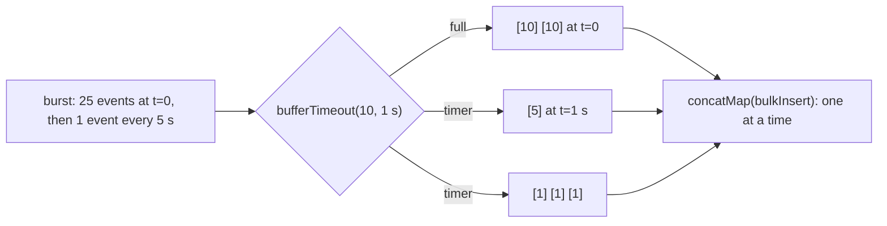

# 5. Batch Writes by Size or Time

<span class="level l2">L2</span> ★★☆ · `bufferTimeout`, `concatMap`, virtual time

## Problem

> Events arrive in bursts and trickles. Write them to the database in **batches of up to 10**, or **after 1 second**, whichever comes first,
> with **one batch in flight at a time** so the DB isn't overloaded and order is preserved. Test it without waiting in real time.

## Key idea

`bufferTimeout(maxSize, maxWait)` emits a batch when it's full **or** when the timer started by its first element fires. That gives
low latency for trickles and efficiency for bursts. `concatMap(bulkInsert)` runs one write at a time, in order. `StepVerifier.withVirtualTime`
replaces the clock, so 15 seconds of traffic run in milliseconds.



## Solution

```java title="P05Batcher.java"
--8<-- "playbook-examples/src/main/java/com/example/reactive/playbook/codinginterview/P05Batcher.java"
```

```java title="P05BatcherTest.java"
--8<-- "playbook-examples/src/test/java/com/example/reactive/playbook/codinginterview/P05BatcherTest.java"
```

## Walkthrough

| Code | Why |
|---|---|
| `.bufferTimeout(maxSize, maxWait)` | Size or time. `buffer(10)` alone would hold the last 5 events until 5 more arrived, possibly forever. |
| `.concatMap(bulkInsert)` | `concatMap` subscribes to the next insert only after the previous one completes: ordered, with one batch in flight. `flatMap` would run them concurrently and out of order. |
| `StepVerifier.withVirtualTime(() -> ...)` | The pipeline must be built **inside** the supplier so that `Flux.interval` and the buffer timers use the virtual scheduler. |
| `.expectNext(10, 10).thenAwait(Duration.ofSeconds(1)).expectNext(5)` | Proves both triggers: size-triggered batches immediately, then a time-triggered remainder. |
| `maxInFlight == 1, firstIds == [1, 11, 21]` | The second test checks that there's no overlap between inserts and that the order is kept. |

## Complexity

| Approach | Time | Space |
|---|---|---|
| per event | O(1) | O(batch size) |

## Run it

```bash
./gradlew :playbook-examples:test --tests '*P05BatcherTest'
```

```text
--8<-- "coding-interview/outputs/P05BatcherTest.txt"
```

## Common mistakes

* `buffer(n)` without a timeout. Low-traffic periods never flush.
* Creating the pipeline outside the `withVirtualTime` supplier, so the real clock is used and the test hangs or flakes.
* `flatMap` for writes, which gives unbounded parallel inserts and lost ordering.
* Forgetting that `bufferTimeout` with slow downstream demand can back up. Newer Reactor versions offer a `fairBackpressure` variant.

## Follow-up questions

??? question "How would you make the writes idempotent if a batch is retried?"
    Give events ids and use `INSERT ... ON CONFLICT (id) DO NOTHING` (or a unique constraint plus ignoring duplicates), so retrying a partially applied batch is safe. Retry with `retryWhen` inside `concatMap`.

??? question "window vs buffer?"
    `buffer` collects elements into a `List` (memory for the whole batch). `window` emits a `Flux` per window, so you can stream into the sink without holding the batch, which is useful for large batches or streaming uploads.
