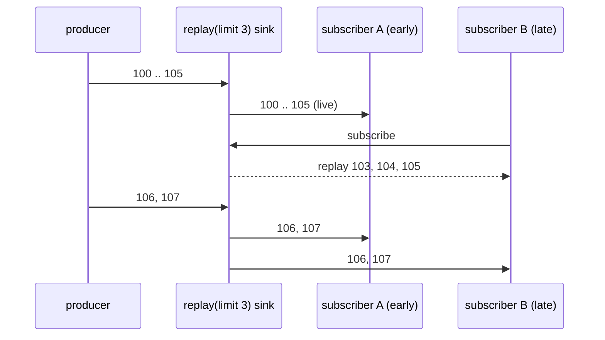

# 6. Hot Price Feed with Replay for Late Subscribers

<span class="level l2">L2</span> ★★☆ · `Sinks.many().replay().limit(n)`, hot vs cold, `asFlux`, subscriber count

## Problem

> One live price feed must serve **many subscribers** (browser tabs over SSE). A subscriber that joins late should **immediately get the
> last 3 prices**, then live ones. Cancelling one subscriber must not affect the others, and completion must reach everyone.

## Key idea

A **sink** is a programmatic, hot publisher. `Sinks.many().replay().limit(3)` multicasts to all subscribers and replays the last
three values to each new one. Expose it **as a `Flux`** (`asFlux()`) so callers can't emit. Producers use `emitNext` with an
explicit failure handler, so concurrent-emission bugs surface instead of being silently dropped.



## Solution

```java title="P06PriceFeed.java"
--8<-- "playbook-examples/src/main/java/com/example/reactive/playbook/codinginterview/P06PriceFeed.java"
```

```java title="P06PriceFeedTest.java"
--8<-- "playbook-examples/src/test/java/com/example/reactive/playbook/codinginterview/P06PriceFeedTest.java"
```

## Walkthrough

| Code | Why |
|---|---|
| `Sinks.many().replay().limit(replayLast)` | Hot plus bounded history. `multicast().onBackpressureBuffer()` has no history; `replay().all()` keeps everything, which is a memory leak for an endless feed. |
| `sink.emitNext(t, Sinks.EmitFailureHandler.FAIL_FAST)` | Sinks are **not** safe for concurrent `emitNext`. FAIL_FAST throws instead of silently dropping. For multiple producer threads, use `busyLooping(Duration)` or serialise the emitters. |
| `public Flux<Tick> ticks() { return sink.asFlux(); }` | Read-only view. Consumers can't call `emitNext` or complete the feed. |
| `subscriberCount() 2 → 1 after dispose` | Cancelling one subscriber leaves the source and the other subscribers running, unlike a cold Flux, where each subscriber has its own source. |

## Complexity

| Approach | Time | Space |
|---|---|---|
| emit | O(subscribers) | O(replay size) |

## Run it

```bash
./gradlew :playbook-examples:test --tests '*P06PriceFeedTest'
```

```text
--8<-- "coding-interview/outputs/P06PriceFeedTest.txt"
```

## Common mistakes

* Using `replay().all()` for an infinite feed, which is unbounded memory.
* Calling `emitNext` from several threads with the default handling, which causes `FAIL_NON_SERIALIZED` drops.
* Returning the `Sinks.Many` itself from an API, which lets any caller emit or complete it.
* Expecting a cold `Flux` to behave like this. Each subscriber would restart the source, for example re-opening the upstream connection per browser tab.

## Follow-up questions

??? question "How do you turn a cold source (one upstream connection) into a shared hot one?"
    `coldFlux.share()` (multicast while subscribers exist), `publish().refCount(n)` or `autoConnect(n)` (start after n subscribers), or `replay(3).refCount()` for history. This way 100 browser tabs share one upstream connection.

??? question "How would you expose this over SSE?"
    `@GetMapping(produces = TEXT_EVENT_STREAM_VALUE) Flux<ServerSentEvent<Tick>> stream() { return feed.ticks().map(t -> ServerSentEvent.builder(t).id(...).build()); }`. Add a heartbeat (`Flux.interval` merged in) so proxies don't close idle connections.
