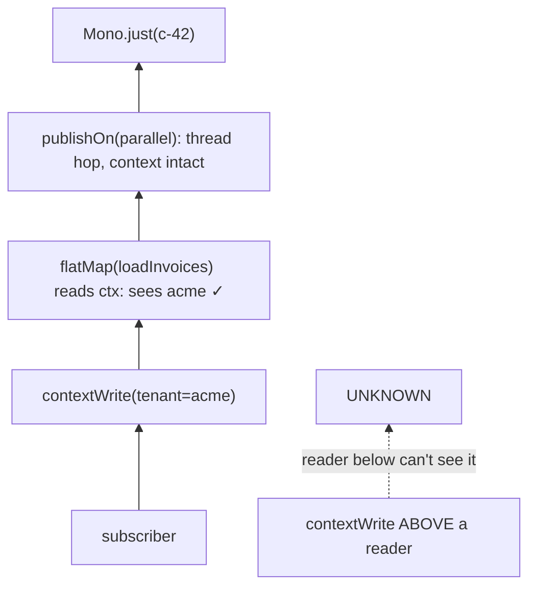

# 7. Propagating Tenant Id with Reactor Context

<span class="level l3">L3</span> ★★★ · `contextWrite`, `deferContextual`, upstream propagation, thread hops

## Problem

> Every query and downstream call must carry the caller's **tenant id**. In reactive code a `ThreadLocal` doesn't work, because operators
> hop threads. Pass the tenant through **Reactor Context**, show it surviving thread changes, and show why **where** you write it matters.

## Key idea

Context is attached to the **subscriber** and flows **upstream**, from the subscriber towards the source. Write it once at the edge
(`contextWrite`, typically in a `WebFilter`) and read it anywhere *above* that point (`Mono.deferContextual`). An inner `contextWrite`
overrides the value for its own subtree only.



## Solution

```java title="P07TenantContext.java"
--8<-- "playbook-examples/src/main/java/com/example/reactive/playbook/codinginterview/P07TenantContext.java"
```

```java title="P07TenantContextTest.java"
--8<-- "playbook-examples/src/test/java/com/example/reactive/playbook/codinginterview/P07TenantContextTest.java"
```

## Walkthrough

| Code | Why |
|---|---|
| `Mono.deferContextual(ctx -> ... ctx.getOrDefault(TENANT, "UNKNOWN"))` | Reads the Context at subscription time. `getOrDefault` makes a missing tenant visible instead of throwing deep inside a query. |
| `pipeline.contextWrite(Context.of(TENANT, tenant))` | Write at the **end** of the chain, as the outermost operator. It applies to everything above it. |
| `.publishOn(Schedulers.parallel())` | The test hops threads before reading, which is exactly where a `ThreadLocal` would lose the value. |
| `placementMatters_contextOnlyFlowsUpstream` | `contextWrite` placed above the reader has no effect on it, and the test gets UNKNOWN. This is the most common Context bug. |
| `innerWriteOverridesOuter_forItsSubtreeOnly` | Nested writes shadow outer values for the part of the chain above them, which is handy for impersonation or per-call overrides. |

## Complexity

| Approach | Time | Space |
|---|---|---|
| read / write | O(1) | O(entries), immutable |

## Run it

```bash
./gradlew :playbook-examples:test --tests '*P07TenantContextTest'
```

```text
--8<-- "coding-interview/outputs/P07TenantContextTest.txt"
```

## Common mistakes

* Using `ThreadLocal` or MDC directly. The values vanish after `publishOn`, `flatMap` on another scheduler, or a WebClient call.
* Putting `contextWrite` in the middle of a chain and expecting operators below it to see the value.
* Storing large or mutable objects in Context. It's meant for small, immutable request metadata.

## Follow-up questions

??? question "How do you get the tenant into log lines (MDC)?"
    Turn on automatic context propagation: `Hooks.enableAutomaticContextPropagation()` with Micrometer's `context-propagation` and registered `ThreadLocalAccessor`s. In Boot, `spring.reactor.context-propagation=auto`. Reactor then restores ThreadLocals such as MDC from Context around each operator.

??? question "How does a WebFilter set it for every request?"
    `(exchange, chain) -> chain.filter(exchange).contextWrite(Context.of(TENANT, exchange.getRequest().getHeaders().getFirst("X-Tenant")))`. Validate the header against the authenticated principal; never trust it blindly.
