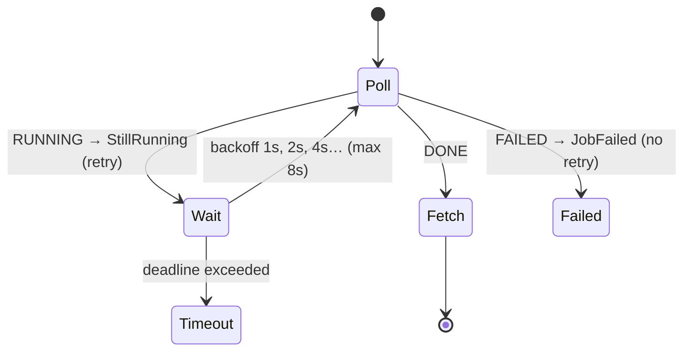

# 8. Poll a Job Until Done (Backoff + Deadline)

<span class="level l2">L2</span> ★★☆ · `retryWhen(Retry.backoff)` with filter, `timeout`, `Mono.defer`

## Problem

> Starting a report export returns immediately. Poll its status with **exponential backoff** until it's DONE (then fetch the result) or FAILED
> (stop at once). Give up after an **overall deadline**. Test minutes of polling in milliseconds.

## Key idea

Model "still running" as a **retryable signal**: map RUNNING to a lightweight exception and `retryWhen(Retry.backoff(...).filter(isStillRunning))`.
`Mono.defer` re-runs the status call on each retry. FAILED maps to a different exception, which isn't retried. An outer `timeout`
enforces the deadline over the whole retry loop.



## Solution

```java title="P08JobPoller.java"
--8<-- "playbook-examples/src/main/java/com/example/reactive/playbook/codinginterview/P08JobPoller.java"
```

```java title="P08JobPollerTest.java"
--8<-- "playbook-examples/src/test/java/com/example/reactive/playbook/codinginterview/P08JobPollerTest.java"
```

## Walkthrough

| Code | Why |
|---|---|
| `Mono.defer(statusCall)` | Retrying re-subscribes. Without `defer`, a Mono built once would replay the same cached call. |
| `case RUNNING -> Mono.error(new StillRunning())` | A control-flow signal. `StillRunning` skips stack-trace capture (`super(null, null, false, false)`) because it's thrown often. |
| `Retry.backoff(Long.MAX_VALUE, firstDelay).maxBackoff(8s).filter(e -> e instanceof StillRunning)` | Unlimited attempts, bounded by the timeout instead. Jittered exponential delays, capped at 8 s, and FAILED isn't retried. |
| `.timeout(deadline)` | Placed **after** `retryWhen`, so it covers the whole polling loop, not a single attempt. |
| `polls between 3 and 12 in 30 s` | Proves it's backing off rather than polling in a tight loop. |

## Complexity

| Approach | Time | Space |
|---|---|---|
| polls | O(log(deadline / firstDelay)) before the cap | O(1) |

## Run it

```bash
./gradlew :playbook-examples:test --tests '*P08JobPollerTest'
```

```text
--8<-- "coding-interview/outputs/P08JobPollerTest.txt"
```

## Common mistakes

* `Flux.interval(1s).flatMap(status)` with no backoff, which hammers the status endpoint and keeps polling after DONE unless you add `takeUntil`.
* `timeout` before `retryWhen`, which limits each attempt instead of the total wait.
* Retrying on every error, including FAILED or a 404 for an unknown job id.

## Follow-up questions

??? question "Polling vs callbacks/webhooks vs SSE for long jobs?"
    Polling is simple and works through firewalls, but adds latency and load. Webhooks or callbacks are efficient but need a public endpoint and retries. SSE or WebSockets push status changes in real time. Many APIs offer polling with `Retry-After` hints plus an optional webhook.

??? question "How do you honour a server's Retry-After header?"
    Return the delay from the status call (for example a `StillRunning(Duration)`), and use `retryWhen(Retry.from(signals -> signals.concatMap(s -> Mono.delay(((StillRunning) s.failure()).delay()))))` for server-directed delays.
