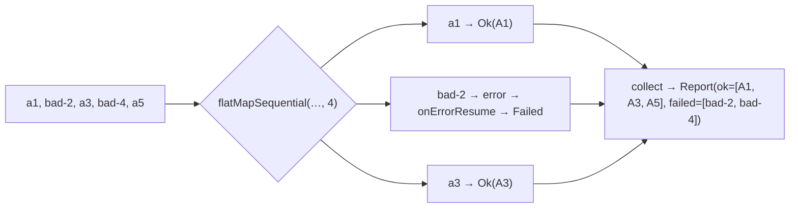

# 9. Partial Results: Don't Let One Bad Row Kill the Import

<span class="level l2">L2</span> ★★☆ · Per-element `onErrorResume`, sealed outcomes, `flatMapSequential`

## Problem

> Import 200 rows concurrently. Bad rows must be **reported with reasons** while good rows still succeed, results must stay in **input order**,
> and the job returns one summary. Show that the naive version fails completely on the first bad row.

## Key idea

An error **terminates** a Reactive Streams sequence. Contain it **inside** the inner publisher of `flatMap`/`flatMapSequential`:
`process(id).map(Ok::new).onErrorResume(e -> Mono.just(new Failed(...)))`. Each element then becomes a value, either `Ok` or `Failed`,
and the outer stream never sees an error. `flatMapSequential` keeps the concurrency but emits in input order.



## Solution

```java title="P09PartialResults.java"
--8<-- "playbook-examples/src/main/java/com/example/reactive/playbook/codinginterview/P09PartialResults.java"
```

```java title="P09PartialResultsTest.java"
--8<-- "playbook-examples/src/test/java/com/example/reactive/playbook/codinginterview/P09PartialResultsTest.java"
```

## Walkthrough

| Code | Why |
|---|---|
| `.<Outcome>map(v -> new Ok(id, v)).onErrorResume(e -> Mono.just(new Failed(id, e.getMessage())))` | The error is handled per element, inside the inner Mono. The explicit `<Outcome>` type witness lets both branches share the sealed type. |
| `flatMapSequential(..., concurrency)` | Runs up to N at a time but emits in source order. Plain `flatMap` would emit in completion order. |
| `withoutPerElementHandling_oneBadRowKillsEverything` | The naive `ids.flatMap(process).collectList()` errors on `bad-2` and cancels all the other in-flight work. |
| `record Report(List<Ok> ok, List<Failed> failed)` | A summary that callers and operators can act on: retry the failed rows, alert, or write them to a dead-letter table. |

## Complexity

| Approach | Time | Space |
|---|---|---|
| per row | O(1) + processing | O(rows) for the report |

## Run it

```bash
./gradlew :playbook-examples:test --tests '*P09PartialResultsTest'
```

```text
--8<-- "coding-interview/outputs/P09PartialResultsTest.txt"
```

## Common mistakes

* Using `onErrorContinue`. It depends on operator support, has surprising semantics, and can leak resources. Prefer explicit per-element `onErrorResume`.
* Putting `onErrorResume` **outside** the `flatMap`. By then the stream has already terminated, and you just replace the whole result.
* Catching errors and returning `Mono.empty()`, so failures disappear without a trace.

## Follow-up questions

??? question "When is failing fast the right behaviour?"
    When the batch must be atomic (a financial file in which all rows must apply or none), or when the error means the whole job is broken (database down). Then stop at once, perhaps after a retry, and roll back or compensate.

??? question "How do you retry only the failed rows?"
    Collect the `Failed` ids and re-run `importAll(Flux.fromIterable(failedIds), ...)` with a retry policy, or give the inner call `retryWhen(...)` before the `onErrorResume`, so transient failures are retried per row and only permanent ones are reported.
