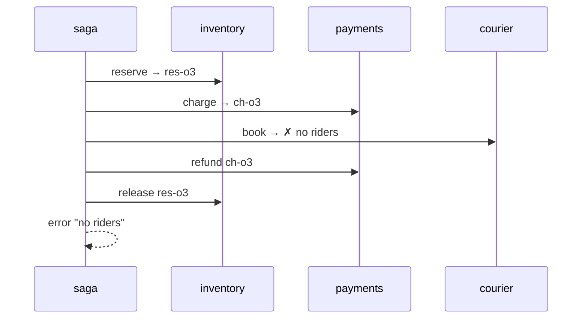

# 10. Reactive Saga with Compensation

<span class="level l3">L3</span> ★★★ · Nested `flatMap`, `onErrorResume` compensations, reverse-order undo

## Problem

> Placing an order **reserves stock → charges the card → books a courier**. If a step fails, undo the completed steps **in reverse order**
> (refund, then release) and surface the **original error**.

## Key idea

Nest the steps so that each one has the previous results **in scope**. Attach `onErrorResume` to each step to run the compensations for the
steps that came before it, then `then(Mono.error(e))` to re-emit the original failure. Payment failure releases the stock. Courier
failure refunds the charge, then releases the stock.



## Solution

```java title="P10OrderSaga.java"
--8<-- "playbook-examples/src/main/java/com/example/reactive/playbook/codinginterview/P10OrderSaga.java"
```

```java title="P10OrderSagaTest.java"
--8<-- "playbook-examples/src/test/java/com/example/reactive/playbook/codinginterview/P10OrderSagaTest.java"
```

## Walkthrough

| Code | Why |
|---|---|
| `inventory.reserve(order).flatMap(reservation -> payments.charge(order)...` | Nesting keeps `reservation` and `charge` in scope for the compensations. Flattening into separate `flatMap`s would lose them. |
| `.onErrorResume(e -> undo(payments.refund(charge), ...).then(undo(inventory.release(reservation), ...)).then(Mono.error(e)))` | Undo in reverse order, then re-throw the original error so the caller sees *why* the order failed. |
| `undo(action, label) → action.doOnSuccess(...)` | The compensations are recorded so the tests can assert exactly which ones ran, and in which order. |
| `paymentFails → ["release res-o2"]` | Only completed steps are compensated. Nothing is refunded if nothing was charged. |

## Complexity

| Approach | Time | Space |
|---|---|---|
| per order | 3 calls (+ up to 2 compensations) | O(1) |

## Run it

```bash
./gradlew :playbook-examples:test --tests '*P10OrderSagaTest'
```

```text
--8<-- "coding-interview/outputs/P10OrderSagaTest.txt"
```

## Common mistakes

* Compensating steps that never completed, for example refunding when the charge itself failed.
* Swallowing the original error after compensating, so the caller gets success or an empty result.
* Assuming compensations always succeed. In production they need retries and idempotency, and a stuck saga needs an alert or manual queue.
* Running the whole saga in memory. A crash mid-saga loses track of it. Durable sagas persist their state (an orchestrator table or a workflow engine).

## Follow-up questions

??? question "Orchestration vs choreography for sagas?"
    Orchestration: one coordinator (like this code, or Temporal, Camunda or Axon) calls each step and its compensation, which makes the flow explicit and easy to monitor. Choreography: services react to each other's events (OrderPlaced, PaymentFailed, ...), which is loosely coupled but harder to follow. Use orchestration for complex flows.

??? question "How do you make this crash-safe?"
    Persist the saga state after each step (an outbox row per transition), make every step and compensation idempotent (keyed by order id), and run a recovery job that resumes or compensates sagas stuck in intermediate states.
