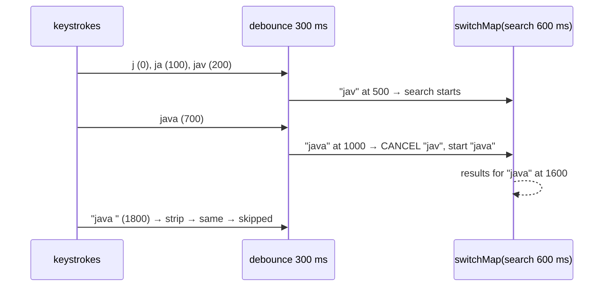

# 11. Search-as-You-Type with switchMap

<span class="level l2">L2</span> ★★☆ · `sampleTimeout` debounce, `distinctUntilChanged`, `switchMap` cancellation

## Problem

> Turn keystrokes into search requests. **Debounce** (wait 300 ms of quiet), ignore queries **shorter than 2** characters, skip
> **repeats**, and when a new query starts, **cancel the in-flight search** so stale results never overwrite newer ones.

## Key idea

`sampleTimeout(q -> Mono.delay(quiet))` is Reactor's debounce: a value is emitted only if no newer value arrives within the window. `distinctUntilChanged`
drops a repeated query. **`switchMap`** subscribes to the search for the newest query and **cancels** the previous one, which is the
operator that fixes the classic out-of-order bug where results arrive late and overwrite newer ones.



## Solution

```java title="P11SearchAsYouType.java"
--8<-- "playbook-examples/src/main/java/com/example/reactive/playbook/codinginterview/P11SearchAsYouType.java"
```

```java title="P11SearchAsYouTypeTest.java"
--8<-- "playbook-examples/src/test/java/com/example/reactive/playbook/codinginterview/P11SearchAsYouTypeTest.java"
```

## Walkthrough

| Code | Why |
|---|---|
| `.map(String::strip)` | Normalise before comparing, so `"java "` and `"java"` count as the same query. |
| `.sampleTimeout(q -> Mono.delay(quiet))` | A value is emitted only if no newer keystroke arrives within `quiet`. Intermediate prefixes such as "j" and "ja" never reach the backend. |
| `.distinctUntilChanged()` | Compares with the previous emitted query only, so "jav", "java", "jav" still searches all three, but "java" twice in a row searches once. |
| `.switchMap(q -> search.apply(q))` | The newest query wins. The test records that "jav" was started and then cancelled (`doOnCancel`), and only the "java" results are emitted. |
| `StepVerifier.withVirtualTime + Mono.delay keystrokes` | Exact timings (0, 100, 200, 700, 1800 ms) are replayed deterministically and instantly. |

## Complexity

| Approach | Time | Space |
|---|---|---|
| per keystroke | O(1) | O(1) (one in-flight search) |

## Run it

```bash
./gradlew :playbook-examples:test --tests '*P11SearchAsYouTypeTest'
```

```text
--8<-- "coding-interview/outputs/P11SearchAsYouTypeTest.txt"
```

## Common mistakes

* `flatMap(search)`: concurrent searches whose late responses for old queries overwrite newer results.
* `concatMap(search)`: searches queue up behind each other and the UI lags further and further.
* Debouncing on the server only. Each keystroke still costs a request; debounce in the client too.

## Follow-up questions

??? question "Does cancellation actually stop the HTTP request?"
    With WebClient, yes: cancelling the subscription closes or releases the connection. Make sure the backend also stops work on client disconnect (WebFlux propagates cancellation to the handler's subscription).

??? question "switchMap vs exhaustMap-style behaviour?"
    `switchMap`: the newest wins and older work is cancelled (search, autocomplete). The opposite, ignoring new triggers while one is in flight (for example a "submit" button), has no direct Reactor operator. Use `onBackpressureDrop` with `concatMap(..., 1)`, or a guard flag.
