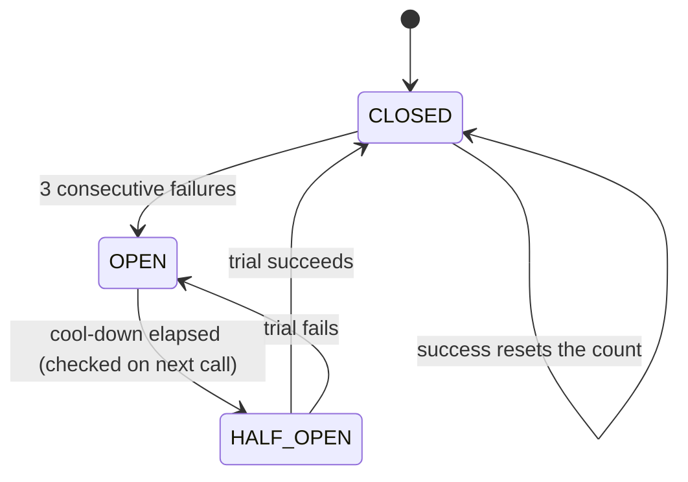

# 12. Write a Reactive Circuit Breaker Operator

<span class="level l3">L3</span> ★★★ · `transformDeferred`, `Mono.defer`, state machine, injectable `Clock`

## Problem

> Implement a circuit breaker that can wrap **any** `Mono`. After 3 consecutive failures it **opens** and fails fast **without calling** the
> dependency. After a 10 s cool-down it allows one **half-open** trial: success closes it, failure reopens it.

## Key idea

Return a `Function<Mono<T>, Mono<T>>` and apply it with **`transformDeferred`**, which re-evaluates the function **per subscription**
(`transform` runs once, at assembly). Inside, `Mono.defer` asks for permission at subscribe time. If the breaker is OPEN, it errors
immediately and the source is never subscribed. Otherwise it subscribes and records the outcome with `doOnSuccess`/`doOnError`.



## Solution

```java title="P12CircuitBreaker.java"
--8<-- "playbook-examples/src/main/java/com/example/reactive/playbook/codinginterview/P12CircuitBreaker.java"
```

```java title="P12CircuitBreakerTest.java"
--8<-- "playbook-examples/src/test/java/com/example/reactive/playbook/codinginterview/P12CircuitBreakerTest.java"
```

## Walkthrough

| Code | Why |
|---|---|
| `source -> Mono.defer(() -> { if (!tryAcquire()) return Mono.error(new CallNotPermitted()); ... })` | The decision happens per subscription. When OPEN, the source Mono is never subscribed, which is what "fail fast" means (the test counts calls). |
| `.transformDeferred(breaker.protect())` | Per-subscriber transformation. With `transform`, the function would run once when the pipeline is built, which is fine here thanks to `defer`, but `transformDeferred` makes the intent explicit. |
| `if (state == OPEN && !now.isBefore(openedAt + openFor)) state = HALF_OPEN` | A lazy transition: no timer thread. The next call after the cool-down becomes the trial. |
| `if (state == HALF_OPEN \|\| consecutiveFailures >= threshold) open()` | A failed trial reopens the circuit immediately and restarts the cool-down. |
| `synchronized methods + injectable Clock` | Simple and correct under concurrency. The test moves time forward instead of sleeping. |

## Complexity

| Approach | Time | Space |
|---|---|---|
| per call | O(1) | O(1) |

## Run it

```bash
./gradlew :playbook-examples:test --tests '*P12CircuitBreakerTest'
```

```text
--8<-- "coding-interview/outputs/P12CircuitBreakerTest.txt"
```

## Common mistakes

* Checking state at **assembly** time (outside `defer`), so a breaker that opens later never blocks already-built pipelines.
* Letting many concurrent trial calls through in HALF_OPEN. Production breakers allow a bounded number of permitted calls.
* Counting client errors (4xx, validation) as failures. Only count failures that say the dependency is unhealthy.
* No fallback: callers get `CallNotPermitted` with nothing to show. Add `onErrorResume(CallNotPermitted.class, ...)` at the call site.

## Follow-up questions

??? question "How does Resilience4j's reactive breaker differ?"
    It uses a sliding window (count- or time-based) and a failure-rate threshold instead of consecutive failures, a slow-call rate, and a configurable number of half-open permits. It publishes events and metrics, and applies via `transformDeferred(CircuitBreakerOperator.of(cb))`, the same shape as here.

??? question "Where should the breaker sit relative to retry and timeout?"
    `timeout` sits innermost, so each attempt is bounded. Retry goes inside the breaker, so each attempt counts as an outcome, and an open breaker stops retries. Order: `call.timeout(...).retryWhen(...).transformDeferred(breaker)`, plus a fallback outside.
