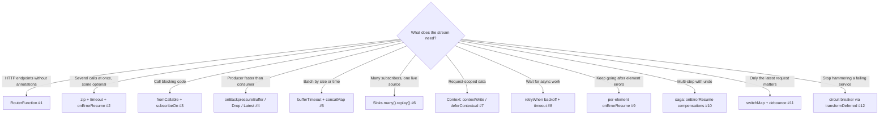

# Coding Interview: 12 Reactor & WebFlux Problems, Solved & Tested

Reactive coding rounds test whether you can **pick the right operator under pressure**: `zip` vs `flatMap`, `switchMap` vs
`concatMap`, where `subscribeOn` goes, what happens to an error inside `flatMap`, why `Mono.just` blocks. They also test whether you
can **prove it with StepVerifier**. These 12 problems are different from the ten in
[Coding Exercises](../interview/coding-exercises.md) and lean more on WebFlux: functional endpoints, WebClient fan-out,
SSE-style hot feeds, Context, sagas and a hand-written circuit breaker.

Every solution lives in
[`playbook-examples/.../codinginterview`](https://github.com/khiruashish/spring-reactive-playbook/tree/main/playbook-examples/src/main/java/com/example/reactive/playbook/codinginterview)
with a test class per problem (39 tests, using **virtual time** wherever time matters, so they run in milliseconds). CI runs them as
part of `./gradlew build`, and each page shows that problem's real test report.

One trap was hit for real while writing the tests, and it's kept as a lesson: StepVerifier sends a leading `thenRequest()`
inside `onSubscribe`, *before* a `Flux.create` producer starts emitting, so the backpressure overflow never happened (problem 4).

Each page follows the same structure:

1. **Problem**: the statement as an interviewer would give it.
2. **Key idea**: the shape of the solution before any code, with a diagram.
3. **Solution**: the complete, runnable code (included from the repository, so it is exactly what CI ran).
4. **Walkthrough**: the important lines and *why* they are written that way.
5. **Complexity**: time and space for each approach.
6. **Run it**: the command and its real output.
7. **Common mistakes** and **follow-up questions** with answers.

## Problem map

| # | Problem | What it tests | Level | Difficulty |
|---|---|---|---|---|
| 1 | [Functional Endpoints: CRUD with Validation](01-functional-endpoints.md) | `RouterFunction`, `ServerRequest`/`ServerResponse`, manual validation, ProblemDetail | <span class="level l1">L1</span> | ★★☆ |
| 2 | [WebClient Fan-Out with Partial Fallbacks](02-webclient-fan-out.md) | `Mono.zip`, per-call `timeout`, `onErrorResume`, required vs optional | <span class="level l2">L2</span> | ★★☆ |
| 3 | [Calling Blocking Code from WebFlux](03-blocking-bridge.md) | `Mono.fromCallable`, `subscribeOn`, dedicated bounded scheduler, `Mono.just` trap | <span class="level l2">L2</span> | ★★☆ |
| 4 | [Backpressure: Buffer, Drop or Keep Latest](04-backpressure.md) | `onBackpressureBuffer` + `DROP_OLDEST`, `onBackpressureDrop`, `onBackpressureLatest`, `limitRate` | <span class="level l3">L3</span> | ★★★ |
| 5 | [Batch Writes by Size or Time](05-batching.md) | `bufferTimeout`, `concatMap`, virtual time | <span class="level l2">L2</span> | ★★☆ |
| 6 | [Hot Price Feed with Replay for Late Subscribers](06-hot-feed-replay.md) | `Sinks.many().replay().limit(n)`, hot vs cold, `asFlux`, subscriber count | <span class="level l2">L2</span> | ★★☆ |
| 7 | [Propagating Tenant Id with Reactor Context](07-reactor-context.md) | `contextWrite`, `deferContextual`, upstream propagation, thread hops | <span class="level l3">L3</span> | ★★★ |
| 8 | [Poll a Job Until Done (Backoff + Deadline)](08-poll-until-done.md) | `retryWhen(Retry.backoff)` with filter, `timeout`, `Mono.defer` | <span class="level l2">L2</span> | ★★☆ |
| 9 | [Partial Results: Don't Let One Bad Row Kill the Import](09-partial-results.md) | Per-element `onErrorResume`, sealed outcomes, `flatMapSequential` | <span class="level l2">L2</span> | ★★☆ |
| 10 | [Reactive Saga with Compensation](10-reactive-saga.md) | Nested `flatMap`, `onErrorResume` compensations, reverse-order undo | <span class="level l3">L3</span> | ★★★ |
| 11 | [Search-as-You-Type with switchMap](11-search-as-you-type.md) | `sampleTimeout` debounce, `distinctUntilChanged`, `switchMap` cancellation | <span class="level l2">L2</span> | ★★☆ |
| 12 | [Write a Reactive Circuit Breaker Operator](12-reactive-circuit-breaker.md) | `transformDeferred`, `Mono.defer`, state machine, injectable `Clock` | <span class="level l3">L3</span> | ★★★ |

Levels: <span class="level l1">L1</span> 0–2 yrs · <span class="level l2">L2</span> 2–5 yrs · <span class="level l3">L3</span> 5–10 yrs · <span class="level l4">L4</span> 10+ yrs / architect.

## Which technique fits? (the interviewer's hidden question)



## How to answer a coding round

1. **Draw the marble diagram first**: what goes in, when, and what comes out. Most bugs are visible on the diagram.
2. **Choose the flattening operator deliberately**: `flatMap` (concurrent, unordered), `flatMapSequential` (concurrent, ordered), `concatMap` (one at a time), `switchMap` (latest wins).
3. **Keep blocking out of the chain**, or isolate it on a bounded scheduler, and say so explicitly.
4. **Test with StepVerifier**, using `withVirtualTime` for anything with delays, timeouts or retries, and assert on the side effects (calls made, cancellations).
5. **Name the failure semantics**: what errors do to the stream, what cancellation does to in-flight work, and where backpressure applies.

## Run every solution

```bash
coding-interview/run-tests.sh          # the 39 coding-interview tests, writes outputs/
coding-interview/run-tests.sh --check  # fails on any failing test or changed report (CI checks the reports after ./gradlew build)
```
