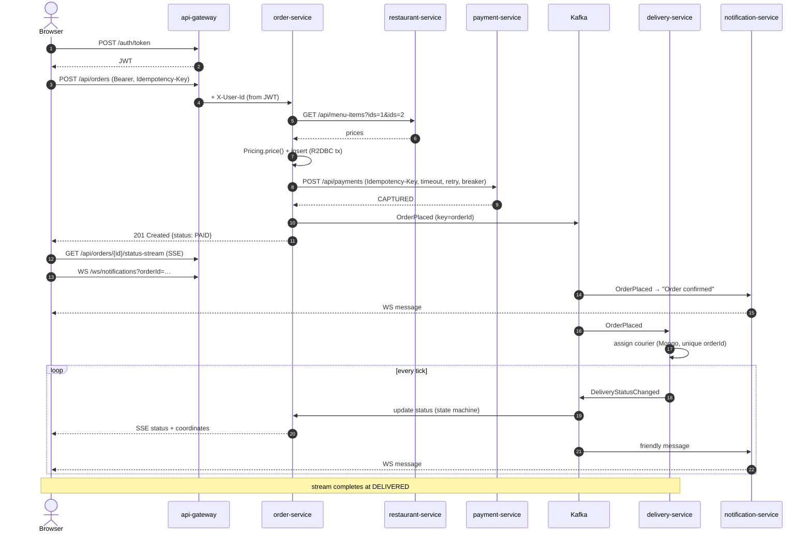

# End-to-End Flow

## Failure paths worth trying

| Scenario | What happens |
|---|---|
| payment-service down | 2 retries with backoff → breaker records failures → order `PAYMENT_FAILED`, no event published |
| breaker open | calls fail fast without touching payment-service; half-open after 10 s |
| duplicate `POST` with same key | original order returned; payment not charged twice |
| Kafka redelivers `OrderPlaced` | unique index in Mongo → no second courier |
| late/out-of-order delivery event | `OrderStatus.canTransitionTo` ignores it |
| browser closes tab | SSE `Flux` cancelled → sink subscription and heartbeat stop |
