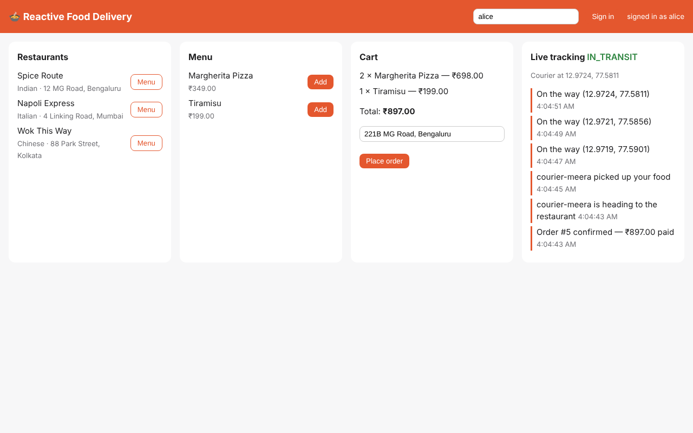
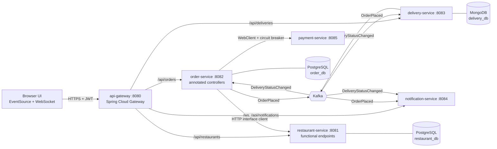

# Food Delivery App — Capstone

Everything from the previous tabs, composed into one **reactive, event-driven microservice platform**:
browse restaurants, place an order, pay, and watch a courier move across the map **live**.



## Architecture



## Which playbook topics live where

| Service | Reactive topics applied |
|---|---|
| [api-gateway](api-gateway.md) | Spring Cloud Gateway, global filters, `ReactiveSecurityContextHolder`, JWT resource server, WebSocket routing, static UI |
| [restaurant-service](restaurant-service.md) | functional endpoints, R2DBC repositories with records, programmatic validation, `onError` → ProblemDetail |
| [order-service](order-service.md) | annotated controllers, ports & adapters, reactive transaction, idempotency, HTTP interface client, WebClient + retry + circuit breaker, Kafka producer/async listener, `Sinks`, SSE with heartbeat |
| [payment-service](payment-service.md) | `Mono.delay`, failure injection, `Mono.cache()` for idempotent replays, virtual-time tests |
| [delivery-service](delivery-service.md) | reactive MongoDB, `Flux.interval` simulation, `concatMap`, `Disposable` lifecycle, SSE tracking |
| [notification-service](notification-service.md) | Kafka → replaying `Sinks.Many` → WebSocket and SSE fan-out |

## Event contracts

```java
// food.order.order.placed.v1  — key: orderId
record OrderPlaced(String orderId, String customerId, String restaurantId, long totalPaise,
                   String deliveryAddress, List<Line> lines, Instant placedAt)

// food.delivery.delivery.status-changed.v1  — key: orderId
record DeliveryStatusChanged(String orderId, String deliveryId, String courierId,
                             DeliveryStatus status, double latitude, double longitude, Instant at)
```

Keying both topics by `orderId` keeps every event of one order on one partition, in order.

## Design rules used throughout

- **Money** is `long` paise — never `double`.
- **Timestamps** are `Instant` / `TIMESTAMPTZ` UTC.
- **Database per service**; services reference each other by id only.
- **Idempotency**: `Idempotency-Key` on order creation and payments; unique index on delivery per order.
- **No `block()`** outside tests; every pipeline is returned to the framework.
- **Pure domain** (`Pricing`, `OrderStatus`) is plain Java, unit-tested in microseconds.
