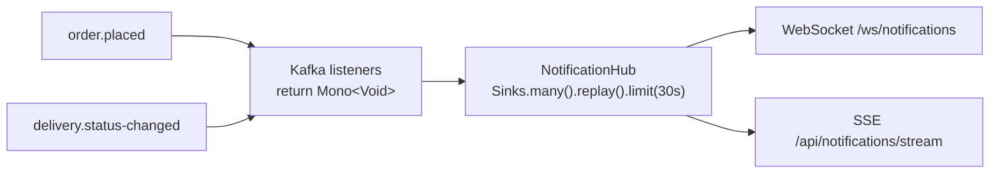

# Notification Service

**Role:** turns domain events into human-readable messages and pushes them to browsers.
**Topics:** [Sinks](../reactor/hot-vs-cold-and-sinks.md), [WebSocket](../webflux/websocket.md),
[SSE](../webflux/streaming-sse.md), [Kafka](../messaging/kafka.md).



## Why a *replay* sink?

The browser opens the WebSocket a moment **after** the order is confirmed. A plain multicast sink would
lose the "Order confirmed" message; `replay().limit(Duration.ofSeconds(30))` hands late subscribers the
last 30 seconds.

## WebSocket handler

```java
--8<-- "food-delivery/notification-service/src/main/java/com/example/fooddelivery/notification/NotificationWebSocketHandler.java:handle"
```

## Friendly messages from events

```java
String message = switch (e.status()) {
    case COURIER_ASSIGNED -> "%s is heading to the restaurant".formatted(e.courierId());
    case PICKED_UP -> "%s picked up your food".formatted(e.courierId());
    case IN_TRANSIT -> "On the way (%.4f, %.4f)".formatted(e.latitude(), e.longitude());
    case DELIVERED -> "Delivered. Enjoy your meal!";
};
```

An exhaustive `switch` over the enum: adding a status breaks the build here until it is handled.
