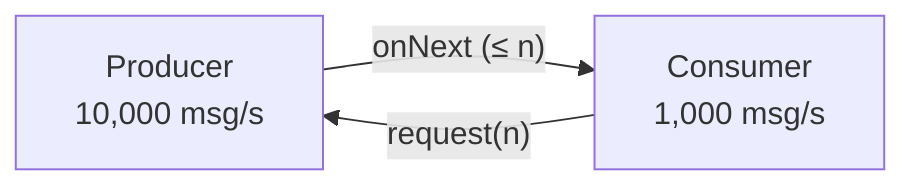

# Backpressure

**Backpressure** is the ability of a consumer to tell a producer *how much* it can handle, so a fast
producer cannot overwhelm a slow consumer (out-of-memory, unbounded queues, latency spikes).

In Reactive Streams it is built into the protocol: `Subscription.request(n)`.



## Pull, push, or both

- **Pull** (iterator): consumer asks for each item — safe but chatty.
- **Push** (callbacks/events): producer sends whenever it likes — fast but can overflow.
- **Reactive Streams = dynamic push-pull**: the consumer requests a *batch* (`request(256)`), the
  producer pushes up to that many, then waits for more demand.

## A subscriber controlling demand

```java
--8<-- "playbook-examples/src/test/java/com/example/reactive/playbook/reactor/BackpressureTest.java:request"
```

## When the producer cannot slow down

Some sources ignore demand: UI events, sensor feeds, a market ticker, messages pushed by a broker.
Then you must decide what to do with the excess — **drop**, **keep only the latest**, **buffer**
(bounded!), or **error**. Reactor's strategies are covered in
[Backpressure & Batching](../reactor/backpressure-and-batching.md).

## Backpressure across the network

| Transport | Backpressure? |
|---|---|
| Reactive Streams in-process | ✅ `request(n)` |
| HTTP/1.1 response body (WebFlux) | ✅ via TCP flow control — Netty stops reading/writing when buffers fill |
| SSE / WebSocket | ⚠️ only TCP-level; the server must still choose a strategy for slow clients |
| RSocket | ✅ `request(n)` crosses the network as frames |
| Kafka | ✅ consumer pulls at its own pace (`max.poll.records`) |

!!! tip "Takeaway"
    Every unbounded buffer is a latent `OutOfMemoryError`. In reactive code, demand flows **upstream**,
    data flows **downstream** — design both directions.
