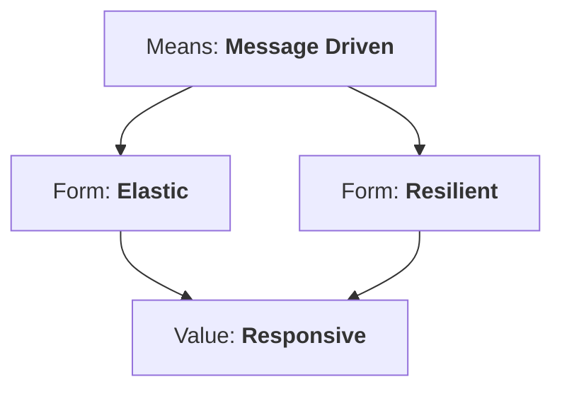

# The Reactive Manifesto

The [Reactive Manifesto](https://www.reactivemanifesto.org/) (2014) describes the **system-level**
properties that reactive *architecture* aims for. Reactive *programming* (Reactor, WebFlux) is one tool to
get there.

| Property | Meaning | How Spring delivers it |
|---|---|---|
| **Responsive** | answers in a timely, consistent manner | non-blocking I/O, `timeout()`, streaming partial results |
| **Resilient** | stays responsive in the face of failure | `retryWhen`, circuit breakers, fallbacks, bulkheads, isolation per service |
| **Elastic** | stays responsive under varying load | few threads handle many connections; stateless services scale horizontally |
| **Message driven** | asynchronous message passing, location transparency, backpressure | Reactive Streams signals, Kafka, RSocket, SSE/WebSocket |

## Reactive programming vs reactive systems

- **Reactive programming** — a *code-level* paradigm: asynchronous data streams + operators
  (Reactor's `Mono`/`Flux`). Scope: one process.
- **Reactive systems** — an *architecture*: services that communicate asynchronously, isolate
  failures and scale elastically. Scope: the whole platform.

You can build a reactive system with imperative services that talk over Kafka, and you can write
reactive code inside a monolith. The capstone in this playbook does **both**: reactive code in every
service *and* asynchronous, event-driven communication between them.

!!! note "Takeaway"
    Use the manifesto as a checklist for design reviews: *what happens to latency when this dependency
    is slow? when it is down? when traffic triples?*
