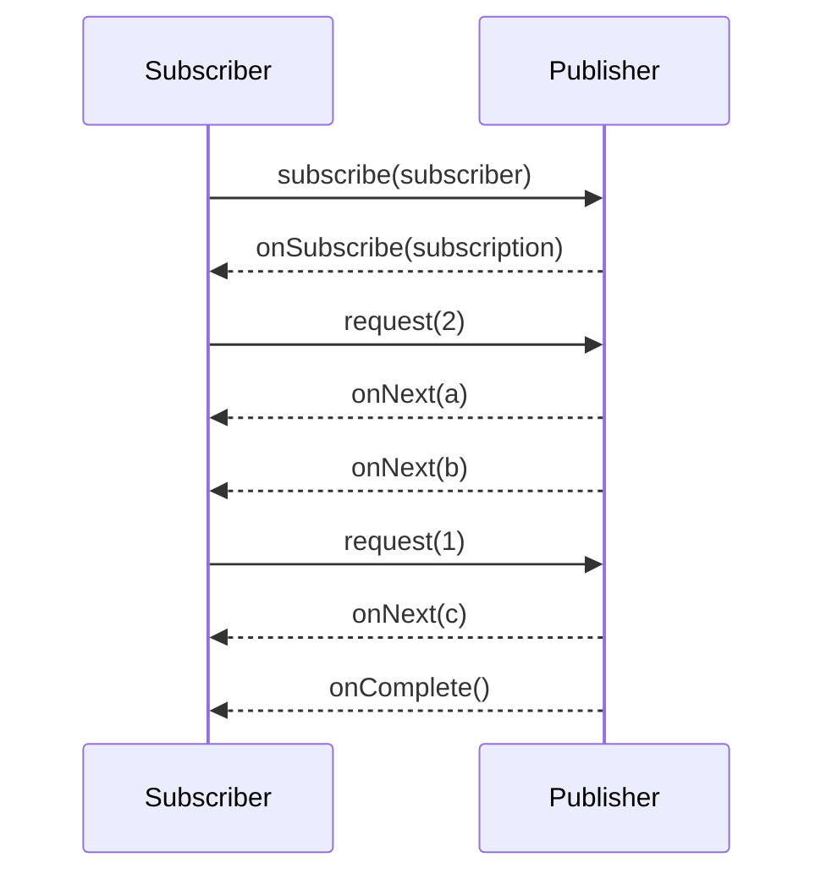

# The Reactive Streams Specification

[Reactive Streams](https://www.reactive-streams.org/) is a tiny standard (4 interfaces, ~40 rules) for
**asynchronous stream processing with non-blocking backpressure**. Reactor, RxJava, Akka Streams,
Mutiny and the JDK's `java.util.concurrent.Flow` all implement it, so they interoperate.

## The four interfaces

```java
public interface Publisher<T> {
    void subscribe(Subscriber<? super T> s);
}

public interface Subscriber<T> {
    void onSubscribe(Subscription s);   // exactly once, first
    void onNext(T t);                   // 0..N times, never more than requested
    void onError(Throwable t);          // terminal
    void onComplete();                  // terminal
}

public interface Subscription {
    void request(long n);               // backpressure: "I can take n more"
    void cancel();                      // stop, release resources
}

public interface Processor<T, R> extends Subscriber<T>, Publisher<R> { }
```

## The protocol



The signal grammar is: `onSubscribe onNext* (onError | onComplete)?`

## Rules worth memorising

1. **Nothing happens until `subscribe`** — and nothing is emitted until `request(n)`.
2. A publisher **must not emit more `onNext` than requested** — this *is* backpressure.
3. Signals are **serial**: never two `onNext` calls concurrently on the same subscriber.
4. `onError` and `onComplete` are **terminal**: no signal may follow them.
5. `null` elements are forbidden.
6. `cancel()` must eventually stop emissions and release resources.

!!! warning "You almost never implement these interfaces yourself"
    Writing a spec-compliant `Publisher` is notoriously hard (concurrency, re-entrancy, demand
    accounting). Use Reactor's factories (`Flux.create`, `Flux.generate`, `Sinks`) instead — see
    [Creating Sequences](../reactor/creating-sequences.md).

## Reactor's view of the spec

| Spec | Reactor |
|---|---|
| `Publisher<T>` with 0..1 elements | `Mono<T>` |
| `Publisher<T>` with 0..N elements | `Flux<T>` |
| `Subscriber` | `CoreSubscriber`, `BaseSubscriber`, lambdas passed to `subscribe(...)` |
| `Processor` | deprecated — use `Sinks` |
| `java.util.concurrent.Flow` | `JdkFlowAdapter` converts both ways |

Watch the protocol with `.log()`:

```java
Flux.range(1, 3).log().subscribe();
// onSubscribe(FluxRange.RangeSubscription)
// request(unbounded)
// onNext(1)
// onNext(2)
// onNext(3)
// onComplete()
```
