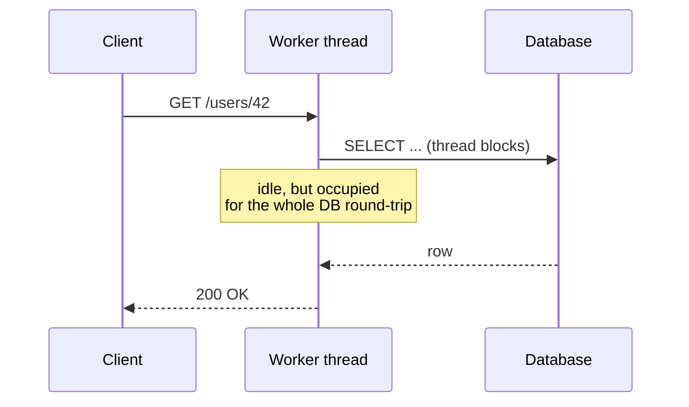
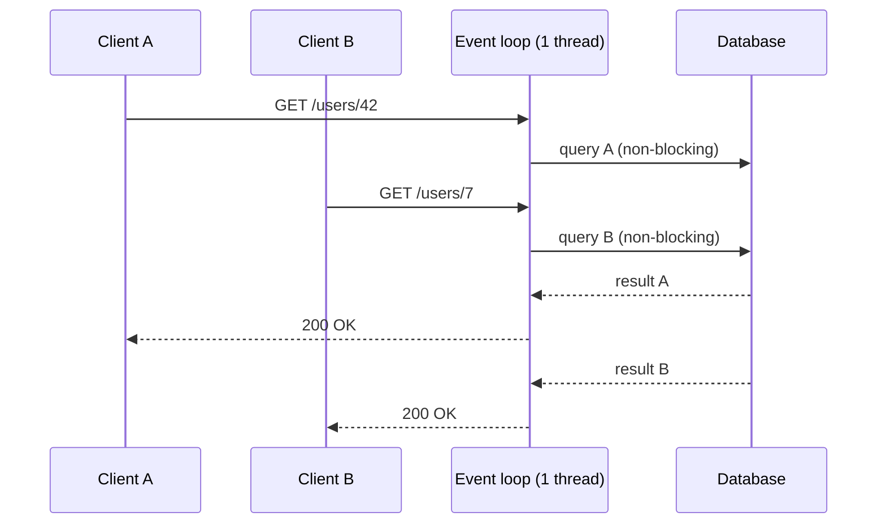

# Why Reactive?

## The thread-per-request model

A classic servlet application (Spring MVC on Tomcat) gives each request its own thread. While that
thread waits for a database or an HTTP call, it is **parked** — holding ~1 MB of stack and doing nothing.



With 200 threads and calls that take 100 ms each, the server tops out around 2,000 requests/second —
regardless of how idle the CPU is. Raising the pool size costs memory and context-switching.

## The event-loop model

A reactive server (Netty) runs a **small, fixed number of event-loop threads** (≈ CPU cores). Nothing
ever blocks: when a request needs I/O, the code registers *what to do when the result arrives* and the
thread immediately moves on to other work.



## What "reactive programming" means in code

You describe a **pipeline** of transformations over values that will arrive *later*:

```java
Mono<UserView> view = userRepository.findById(id)        // Mono<User> — 0 or 1 value, later
        .flatMap(user -> ordersClient.recentOrders(user.id())   // async call, no blocking
                .collectList()
                .map(orders -> new UserView(user, orders)))
        .timeout(Duration.ofSeconds(2));                  // declarative time limit
```

Nothing executes on that line. The pipeline runs when the framework **subscribes** (in WebFlux, when
the HTTP response is written).

## When reactive pays off

| Good fit | Poor fit |
|---|---|
| Many concurrent, I/O-bound requests (gateways, BFFs, aggregators) | CPU-bound batch computation |
| Streaming: SSE, WebSocket, Kafka → client fan-out | Simple CRUD with low concurrency |
| Fan-out/fan-in to many downstream services | Teams/libraries that are entirely blocking (JDBC, JPA) |
| Backpressure-aware pipelines (producer faster than consumer) | Code where debugging simplicity outweighs throughput |

!!! tip "Rule of thumb"
    Reactive is a tool for **I/O concurrency and streaming**. If your bottleneck is CPU, reactive will
    not make it faster — and Java 21 virtual threads may give you most of the scalability benefit with
    plain imperative code. See [Reactive vs Virtual Threads](reactive-vs-virtual-threads.md).

## Key takeaways

- Blocking wastes threads; event loops multiplex many requests over few threads.
- Reactive code is **declarative and lazy**: you build a pipeline, subscription executes it.
- The benefit is **scalability and streaming under I/O load**, not raw speed per request.
