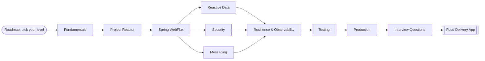

Java 21 · Spring Boot 4.1 · Project Reactor 3.8

<h1>Spring Reactive Playbook</h1>

Reactive programming with <b>Project Reactor</b>, <b>Spring WebFlux</b> and Spring Boot 4, from the Reactive Streams spec to a production food-delivery microservice. Every example is real, tested code.

[Start with the roadmap](roadmap/index.md){ .md-button .md-button--primary }
[Project Reactor](reactor/index.md){ .md-button }
[Food Delivery App](food-delivery/index.md){ .md-button }

Non-blocking I/O<small>epoll · Netty channels</small>

Reactor Netty event loop<small>a few threads, many connections</small>

Project Reactor operators<small>map · flatMap · backpressure</small>

Your handlers<small>Mono · Flux · WebFlux</small>

How a few event-loop threads serve thousands of concurrent requests

<b>98</b>pages

<b>12</b>sections

<b>18</b>diagrams

<b>93</b>Java source files

A complete, hands-on guide to **reactive programming with Spring** — from the Reactive Streams
specification to production microservices — built on **Java 21+** and **Spring Boot 4.1.2**
(Spring Framework 7, Project Reactor 3.8, Reactor Netty 1.3).

!!! success "Every example is real code"
    The Reactor and WebFlux examples in this playbook are not pasted text: they live in the
    `playbook-examples` module as **97 passing JUnit tests** and are embedded into these pages at build
    time. If an example breaks, the docs build breaks.

-   :material-stairs-up:{ .lg .middle } **Career Roadmap: 0 → 15+ years**

    ---
    Five levels from Foundation to Architect, each with topics, exercises and a checkpoint.

    [:octicons-arrow-right-24: Find your level](roadmap/index.md)

-   :material-account-tie-voice:{ .lg .middle } **Interview Questions**

    ---
    110 questions with detailed answers by experience band, plus tested coding exercises, "what does
    this print?" puzzles and system-design scenarios.

    [:octicons-arrow-right-24: Practise](interview/index.md)

-   :material-school:{ .lg .middle } **Fundamentals**

    ---
    Why reactive exists, the Reactive Manifesto, the Reactive Streams contract, backpressure, and
    an honest comparison with virtual threads.

    [:octicons-arrow-right-24: Start here](fundamentals/index.md)

-   :material-water:{ .lg .middle } **Project Reactor**

    ---
    `Mono` and `Flux`, 80+ operators grouped by intent, schedulers, hot vs cold, Sinks, Context,
    debugging — each with a tested example.

    [:octicons-arrow-right-24: Learn Reactor](reactor/index.md)

-   :material-web:{ .lg .middle } **Spring WebFlux**

    ---
    Netty and the event loop, annotated and functional endpoints, WebClient, HTTP interface clients,
    SSE, WebSocket, error handling with RFC 9457.

    [:octicons-arrow-right-24: Build APIs](webflux/index.md)

-   :material-database:{ .lg .middle } **Data, Security, Messaging**

    ---
    R2DBC, reactive MongoDB and Redis, reactive transactions, Spring Security for WebFlux, OAuth2/JWT,
    Kafka, RSocket and Spring Cloud Gateway.

    [:octicons-arrow-right-24: Go deeper](data/index.md)

-   :material-shield-check:{ .lg .middle } **Resilience, Testing, Production**

    ---
    Timeouts, retries, circuit breakers, observability, StepVerifier, WebTestClient, Testcontainers,
    BlockHound, tuning and anti-patterns.

    [:octicons-arrow-right-24: Ship it](resilience/index.md)

-   :material-moped:{ .lg .middle } **Capstone: Food Delivery App**

    ---
    Six reactive microservices — gateway, restaurants, orders, payments, delivery tracking and live
    notifications — wired with Kafka, R2DBC, MongoDB, SSE and WebSocket.

    [:octicons-arrow-right-24: See it all together](food-delivery/index.md)

## How this playbook is organised

The **Roadmap** tab maps every page to an experience level (0–2, 2–5, 5–8, 8–12, 12–15+ years) and the
**Interview** tab tests each level. Every topic tab uses **small, generic examples** (numbers, users, products, price tickers) so each
concept is seen in isolation. The final **Food Delivery App** tab composes all of them into one
event-driven system you can run with Docker Compose.

## Versions used

| Component | Version |
|---|---|
| Java | 21 (works unchanged on 25 LTS) |
| Spring Boot | 4.1.2 |
| Spring Framework / WebFlux | 7.0.10 |
| Project Reactor (reactor-core) | 3.8.8 |
| Reactor Netty | 1.3.8 |
| Spring Security | 7.1.2 |
| Spring Data R2DBC / MongoDB | 2026.0 (4.1.x) |
| Spring Kafka / Kafka clients | 4.1.2 / 4.2.2 |
| Spring Cloud (Gateway 5.0, CircuitBreaker) | 2025.1.4 |
| Jackson | 3.1 (`tools.jackson.*`) |
| Build | Gradle 9.1 (Kotlin DSL + version catalog) |
| Docs | MkDocs + Material for MkDocs |
