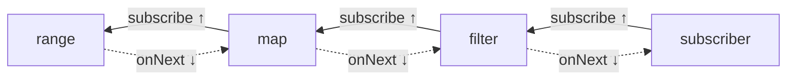

# Advanced: Internals, Custom Operators & Interop

## Assembly, subscription, execution

Each operator call creates a new `Publisher` wrapping the previous one (**assembly**). `subscribe()`
walks the chain **upwards**, creating one `Subscriber` per operator (**subscription**); then `request(n)`
travels up and `onNext` signals flow down (**execution**).



## Operator fusion

Reactor negotiates **fusion** between adjacent operators: *macro-fusion* replaces operators at assembly
(e.g. `Flux.just(x)` → scalar `Mono`), *micro-fusion* lets operators share a queue or iterate directly
(`SYNC`/`ASYNC` modes). A long synchronous chain therefore costs about as much as a loop.

```java
--8<-- "playbook-examples/src/test/java/com/example/reactive/playbook/reactor/AdvancedTest.java:fusion"
```

## Prefetch and queues

Asynchronous boundaries (`publishOn`, `flatMap`, `concatMap`, `zip`) hold **queues** with a prefetch
(`Queues.SMALL_BUFFER_SIZE` = 256 by default, `XS` = 32). They request `prefetch` upstream and replenish
at 75% (`limitRate` semantics). Tune with operator overloads (`publishOn(s, 32)`, `flatMap(f, 16, 8)`).

## Introspection with `Scannable`

```java
--8<-- "playbook-examples/src/test/java/com/example/reactive/playbook/reactor/AdvancedTest.java:scannable"
```

## Writing your own operator

Prefer **composition** over implementing `Publisher`/`Subscriber`:

```java
--8<-- "playbook-examples/src/test/java/com/example/reactive/playbook/reactor/AdvancedTest.java:customOperator"
```

| Tool | Use |
|---|---|
| `transform(fn)` | reusable chain, applied once at assembly |
| `transformDeferred(fn)` | per-subscriber chain (state, Context-dependent logic) |
| `transformDeferredContextual((flux, ctx) -> …)` | chain that reads the Context |
| `Operators.lift(...)` / `Operators.liftPublisher(...)` | decorate every subscriber (metrics, tracing hooks) — rarely needed |
| `Hooks.onEachOperator(key, fn)` | apply a lift to *every* operator globally (instrumentation libraries) |

## Interoperability

=== "JDK Flow"

    ```java
    --8<-- "playbook-examples/src/test/java/com/example/reactive/playbook/reactor/AdvancedTest.java:flowAdapter"
    ```

=== "Spring ReactiveAdapterRegistry"

    ```java
    --8<-- "playbook-examples/src/test/java/com/example/reactive/playbook/reactor/AdvancedTest.java:adapterRegistry"
    ```

=== "RxJava / Mutiny / Kotlin"

    | Library | Bridge |
    |---|---|
    | RxJava 3 | `Flowable.fromPublisher(flux)`, `Flux.from(flowable)` — both are Reactive Streams |
    | SmallRye Mutiny | `Multi.createFrom().publisher(flux)`, `Flux.from(multi)` |
    | Kotlin coroutines | `mono.awaitSingle()`, `flux.asFlow()`, `flow.asFlux()` |
    | `CompletableFuture` | `Mono.fromFuture`, `mono.toFuture()` |

    Spring MVC and WebFlux accept any type registered in `ReactiveAdapterRegistry` as a return value.

## Reactor add-ons worth knowing

| Library | What |
|---|---|
| `reactor-pool` | generic reactive object pool (it powers `r2dbc-pool`) |
| `reactor-extra` | `MathFlux` (sum/average/min/max), `BooleanUtils`, extra retry helpers |
| `reactor-core-micrometer` | `tap(Micrometer.metrics(...))`, `Micrometer.observation(...)` |
| `reactor-tools` | `ReactorDebugAgent` |
| `blockhound` | blocking-call detector |
| Reactive Streams TCK | verify a custom `Publisher` against the spec rules |
