# Combining

## `zip` — wait for all, combine

The classic **parallel fan-out / fan-in**: call independent services concurrently, combine results.

```java
--8<-- "playbook-examples/src/test/java/com/example/reactive/playbook/reactor/CombiningOperatorsTest.java:zip"
```



```mermaid
gantt
    dateFormat X
    axisFormat %L ms
    section sequential (flatMap chain)
    name   :0, 30
    orders :30, 50
    tier   :50, 60
    section Mono.zip
    name   :0, 30
    orders :0, 20
    tier   :0, 10
```

`Flux.zip`/`zipWith` pairs elements **by index** and stops at the shortest source.

## `merge` vs `concat`

```java
--8<-- "playbook-examples/src/test/java/com/example/reactive/playbook/reactor/CombiningOperatorsTest.java:mergeConcat"
```

| | `merge` | `concat` | `mergeSequential` |
|---|---|---|---|
| Subscribes | all at once | one after another | all at once |
| Order | by arrival time | source by source | source by source (buffers) |

## `combineLatest` — recompute when any input changes

```java
--8<-- "playbook-examples/src/test/java/com/example/reactive/playbook/reactor/CombiningOperatorsTest.java:combineLatest"
```

## `firstWithValue` — race (hedged requests)

```java
--8<-- "playbook-examples/src/test/java/com/example/reactive/playbook/reactor/CombiningOperatorsTest.java:first"
```

`Mono.firstWithSignal` takes the first *signal* of any kind (including errors and empty completion).

## Sequencing: `then`, `thenMany`, `when`, `startWith`

```java
--8<-- "playbook-examples/src/test/java/com/example/reactive/playbook/reactor/CombiningOperatorsTest.java:then"
```

!!! example "Choosing quickly"
    - Need **all** results together → `zip`
    - Need **all** results as they come → `merge` / `flatMap`
    - Need them **in order** → `concat` / `concatMap`
    - Need **the fastest** → `firstWithValue`
    - Need **the latest of each** → `combineLatest`
    - Only need **completion** → `then` / `when`
