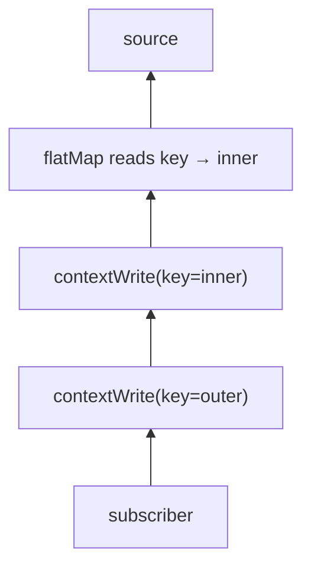

# Context

In reactive code one request hops across many threads, so `ThreadLocal` (MDC, security context,
tenant id, transaction) does not work. Reactor's **`Context`** is an immutable key/value map attached
to the *subscription* instead of the thread.

## Writing and reading

```java
--8<-- "playbook-examples/src/test/java/com/example/reactive/playbook/reactor/ContextAndResourcesTest.java:context"
```

## It flows from the subscriber **upwards**

`contextWrite` is visible to operators **above** it (closer to the source). The write nearest to the
reader wins:

```java
--8<-- "playbook-examples/src/test/java/com/example/reactive/playbook/reactor/ContextAndResourcesTest.java:contextOrder"
```



## Where Spring uses Context

| Feature | Key / API |
|---|---|
| Spring Security | `ReactiveSecurityContextHolder.getContext()` |
| Reactive transactions | `TransactionContext` (managed by `@Transactional` / `TransactionalOperator`) |
| Micrometer tracing / observation | automatic context propagation (see [Observability](../resilience/observability.md)) |
| Your own `WebFilter` | `chain.filter(exchange).contextWrite(ctx -> ctx.put(...))` — see [Filters](../webflux/filters.md) |

!!! tip "Testing with Context"
    `StepVerifier.create(mono, StepVerifierOptions.create().withInitialContext(Context.of(...)))` —
    see [StepVerifier](../testing/stepverifier.md).
