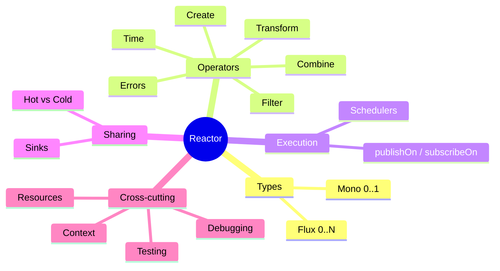

# Project Reactor

[Project Reactor](https://projectreactor.io/) is the Reactive Streams library underneath Spring WebFlux,
Spring Data reactive repositories, Spring Security's reactive stack and Spring Cloud Gateway.
Mastering it is 80% of mastering reactive Spring.



## Dependency

Spring Boot manages the version (reactor-core **3.8.8** with Boot 4.1.2). `spring-boot-starter-webflux`
already includes it; for a plain library:

```kotlin
dependencies {
    implementation(platform("org.springframework.boot:spring-boot-dependencies:4.1.2"))
    implementation("io.projectreactor:reactor-core")
    testImplementation("io.projectreactor:reactor-test")
}
```

## Reading marble diagrams

Reactor's Javadoc explains operators with **marble diagrams**: a timeline per sequence, circles for
`onNext`, `|` for `onComplete`, `X` for `onError`. This playbook uses small tables and tests instead,
but the official diagrams are worth opening for any operator you meet for the first time.

!!! info "All examples on these pages are tests"
    Source: `playbook-examples/src/test/java/com/example/reactive/playbook/reactor/`. Run them with
    `./gradlew :playbook-examples:test`.
