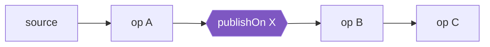

# Schedulers & Threading

Reactor is **concurrency-agnostic**: by default everything runs on the thread that called `subscribe`
(or the thread that emitted the signal — e.g. a Netty event loop). Schedulers let you move work.

## Built-in schedulers

| Scheduler | Threads | Use for |
|---|---|---|
| `Schedulers.immediate()` | current thread | no-op |
| `Schedulers.single()` | 1 reusable thread | low-latency one-off tasks |
| `Schedulers.parallel()` | N = CPU cores | **CPU-bound** work, timers (`interval`, `delay`) |
| `Schedulers.boundedElastic()` | grows to 10 × cores, queues 100k tasks, idle threads evicted | **blocking I/O** you cannot avoid |
| `Schedulers.fromExecutorService(e)` | yours | custom pools, virtual threads |

## `publishOn` vs `subscribeOn`



- **`publishOn(X)`** — switches the thread for operators **below** it. Position matters; you can use
  it several times.
- **`subscribeOn(X)`** — switches the thread on which the **subscription (and so the source)** runs.
  Position doesn't matter; the one closest to the source wins.

=== "publishOn"

    ```java
    --8<-- "playbook-examples/src/test/java/com/example/reactive/playbook/reactor/SchedulersTest.java:publishOn"
    ```

=== "subscribeOn"

    ```java
    --8<-- "playbook-examples/src/test/java/com/example/reactive/playbook/reactor/SchedulersTest.java:subscribeOn"
    ```

## Wrapping blocking calls

The single most important scheduler pattern:

```java
--8<-- "playbook-examples/src/test/java/com/example/reactive/playbook/reactor/SchedulersTest.java:wrapBlocking"
```

!!! danger "Never block an event-loop thread"
    `Thread.sleep`, JDBC, `InputStream.read`, `future.get()`, `block()` on a `reactor-http-nio-*`
    thread stalls *every* connection on that loop. Detect it in tests with
    [BlockHound](../testing/blockhound.md).

## Virtual threads

```java
--8<-- "playbook-examples/src/test/java/com/example/reactive/playbook/reactor/SchedulersTest.java:virtual"
```

## Parallel processing of CPU work

```java
--8<-- "playbook-examples/src/test/java/com/example/reactive/playbook/reactor/SchedulersTest.java:parallel"
```

`flatMap` gives **concurrency** (many async calls in flight); `parallel().runOn()` gives
**parallelism** (CPU work on several cores). For I/O, you almost always want `flatMap`.
