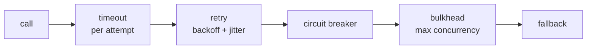
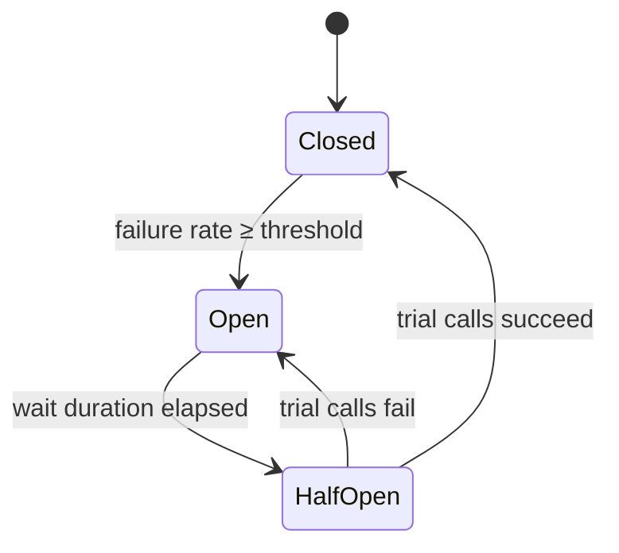

# Resilience Patterns

## The layered defence



| Pattern | Reactor / library | Prevents |
|---|---|---|
| Timeout | `timeout(Duration)` | threads/connections waiting forever |
| Retry | `retryWhen(Retry.backoff(...).jitter(0.5).filter(...))` | failing on transient blips |
| Circuit breaker | Resilience4j `CircuitBreakerOperator` / Spring Cloud `ReactiveCircuitBreaker` | hammering a dead dependency |
| Bulkhead | `flatMap(f, maxConcurrency)`, Resilience4j `BulkheadOperator` | one dependency exhausting all capacity |
| Rate limiter | Resilience4j `RateLimiterOperator`, gateway `RequestRateLimiter` | overload |
| Fallback | `onErrorResume`, `timeout(d, fallback)` | user-visible failure |
| Hedging | `Mono.firstWithValue(primary, delayedSecondary)` | tail latency |

Timeouts and retries are covered in [Error Handling](../reactor/error-handling.md).

## Circuit breaker with Resilience4j (plain library)

```kotlin
implementation("io.github.resilience4j:resilience4j-reactor:2.4.0")
implementation("io.github.resilience4j:resilience4j-circuitbreaker:2.4.0")
```

```java
CircuitBreaker breaker = CircuitBreaker.of("inventory", CircuitBreakerConfig.custom()
        .slidingWindowSize(20)
        .failureRateThreshold(50)                       // open at ≥ 50% failures…
        .slowCallDurationThreshold(Duration.ofSeconds(1))
        .slowCallRateThreshold(80)                      // …or ≥ 80% slow calls
        .waitDurationInOpenState(Duration.ofSeconds(10))
        .permittedNumberOfCallsInHalfOpenState(3)
        .build());

Mono<Stock> stock = inventoryClient.stock(id)
        .timeout(Duration.ofSeconds(2))
        .transformDeferred(CircuitBreakerOperator.of(breaker))   // per-subscription state check
        .onErrorResume(CallNotPermittedException.class, e -> Mono.just(Stock.unknown(id)));
```



## Circuit breaker with Spring Cloud CircuitBreaker

```kotlin
implementation("org.springframework.cloud:spring-cloud-starter-circuitbreaker-reactor-resilience4j")
```

```java
@Bean
Customizer<ReactiveResilience4JCircuitBreakerFactory> defaults() {
    return factory -> factory.configureDefault(id -> new Resilience4JConfigBuilder(id)
            .circuitBreakerConfig(CircuitBreakerConfig.ofDefaults())
            .timeLimiterConfig(TimeLimiterConfig.custom().timeoutDuration(Duration.ofSeconds(3)).build())
            .build());
}

// usage
ReactiveCircuitBreaker cb = factory.create("inventory");
Mono<Stock> guarded = cb.run(inventoryClient.stock(id), error -> Mono.just(Stock.unknown(id)));
```

## Bulkhead with plain Reactor

```java
Flux<Enriched> enriched = products.flatMap(p -> pricing.price(p), 16);  // ≤ 16 concurrent calls
```

## Idempotency makes retries safe

Retries and at-least-once messaging produce **duplicates**. Make writes idempotent:

- client sends an `Idempotency-Key`; the server stores it with a unique constraint and returns the
  original result on replay;
- consumers upsert by business key or record processed event ids.

## Checklist per downstream dependency

- [ ] connect + response timeouts at the HTTP client, plus an operator `timeout`
- [ ] retries only for transient errors and idempotent operations, with backoff + jitter, bounded
- [ ] circuit breaker with a sensible fallback (cached value, degraded response, clear 503)
- [ ] concurrency limit (`flatMap` concurrency or bulkhead)
- [ ] metrics: latency, error rate, breaker state
