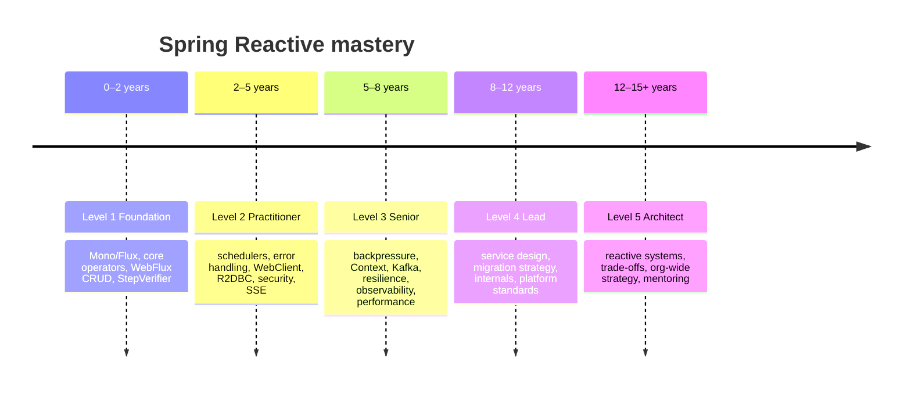

# Career Roadmap: 0 → 15+ Years

A five-level roadmap for growing from your first `Mono` to architecting reactive platforms. Each level
lists **what to master**, **which pages to study**, **hands-on exercises**, a **checkpoint**, and the
matching **interview questions**.

| Level | Experience | You can… | Roadmap | Interview set |
|---|---|---|---|---|
| 1 · Foundation | 0–2 years | build and test a reactive CRUD API | [Level 1](level-1-foundation.md) | [Beginner](../interview/beginner.md) |
| 2 · Practitioner | 2–5 years | integrate databases, services and security without blocking | [Level 2](level-2-practitioner.md) | [Intermediate](../interview/intermediate.md) |
| 3 · Senior | 5–8 years | run event-driven reactive services in production | [Level 3](level-3-senior.md) | [Senior](../interview/senior.md) |
| 4 · Lead | 8–12 years | design multi-service reactive solutions and lead teams through them | [Level 4](level-4-lead.md) | [Lead](../interview/lead.md) |
| 5 · Architect | 12–15+ years | set platform-wide direction: when (not) to go reactive, and how | [Level 5](level-5-architect.md) | [Architect](../interview/architect.md) |

!!! tip "Years are a guide, not a gate"
    Experience bands describe typical scope and depth. Someone with 3 years who has run reactive services
    in production may be at Level 3; a 10-year veteran new to reactive should start at Level 1 — and will
    move fast.

There is also a compact [quick learning path](../learning-path.md) if you only want the reading order.
