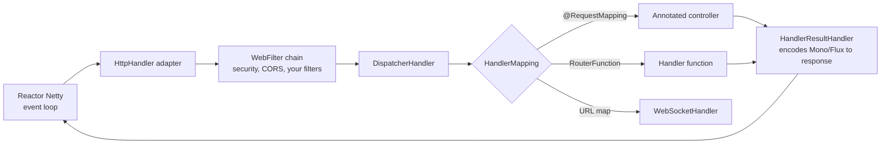

# Architecture

## The request path

- **Reactor Netty** owns sockets; a few `reactor-http-nio-N` threads (default: CPU cores) run *all*
  request processing.
- **`HttpHandler`** is the lowest-level contract (`Mono<Void> handle(request, response)`) — servers
  other than Netty (Tomcat, Jetty, Undertow via Servlet 6.1 non-blocking I/O) adapt to it.
- **`WebFilter`** — cross-cutting interception (Spring Security is a `WebFilter`).
- **`DispatcherHandler`** — the reactive counterpart of MVC's `DispatcherServlet`.
- **`HandlerResultHandler`** — subscribes to your returned `Mono`/`Flux` and streams it out through
  **codecs** (Jackson 3 JSON, SSE, NDJSON, protobuf…).

## Who subscribes?

You return a publisher; WebFlux subscribes to it when writing the response, and **cancels** it if the
client disconnects. That's why handlers must return the full pipeline — work started with a detached
`subscribe()` is invisible to the framework (no backpressure, no cancellation, no error mapping).

## Threading model in practice

| Work | Runs on |
|---|---|
| Request decoding, your controller code, operators | Netty event loop (`reactor-http-nio-*`) |
| R2DBC / WebClient callbacks | their own Netty event loops |
| `Mono.delay`, `interval`, `timeout` timers | `parallel-*` |
| Blocking code you wrapped | `boundedElastic-*` |

!!! warning "Spring MVC and WebFlux on the classpath"
    If both `spring-boot-starter-web` and `spring-boot-starter-webflux` are present, Boot starts **Spring
    MVC** (servlet). Adding WebFlux to an MVC app just to use `WebClient` is fine; force the reactive stack
    with `spring.main.web-application-type=reactive` only if you mean it.
